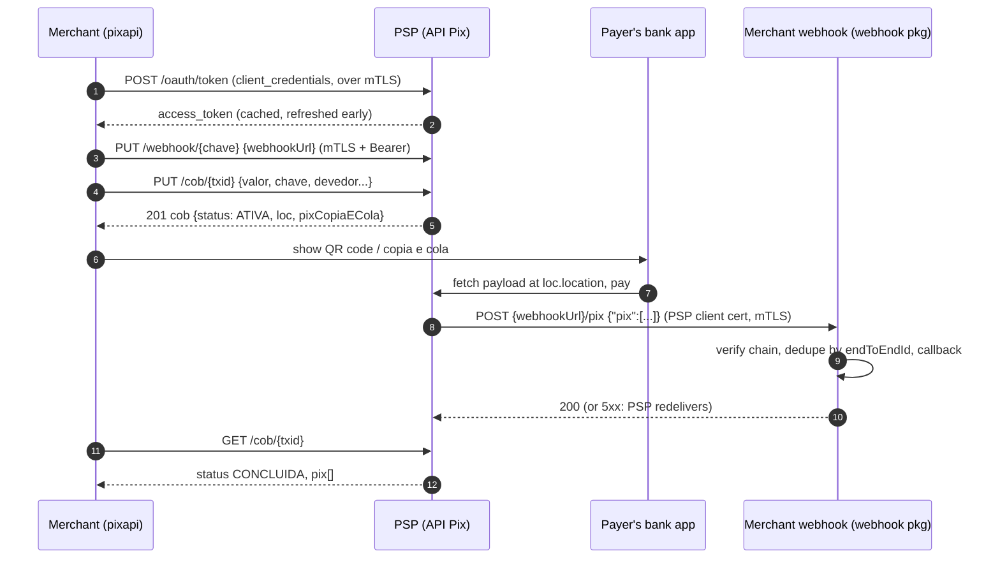

# pix-cobranca-go

[](https://github.com/victorcondackdev/pix-cobranca-go/actions/workflows/ci.yml)
[](https://pkg.go.dev/github.com/victorcondackdev/pix-cobranca-go)

A typed Go client **and** a reference server for the Banco Central do Brasil
**API Pix**: the regulated REST API that every Brazilian PSP exposes to
merchants for Pix charges (`cob`, `cobv`, `lotecobv`), received payments and
refunds (`pix`, `devolução`), webhooks and payload locations (`loc`), behind
OAuth2 client credentials and mutual TLS.

The repository has four parts that are designed to be used together:

| Package | What it is |
|---|---|
| [`pixapi`](./pixapi) | SDK: functional options, mTLS, cached single-flight OAuth2, safe retries, local validation, RFC 7807 errors, pagination iterators. |
| [`webhook`](./webhook) | Receiver for PSP notifications: verifies the PSP's client certificate chain, parses `{"pix":[...]}`, deduplicates, calls your code. |
| [`mockpsp`](./mockpsp), [`cmd/mockpsp`](./cmd/mockpsp) | In-memory PSP: token endpoint, mTLS with certificate-bound tokens, charge lifecycle, BR Code generation, simulated payments that call your webhook over mTLS. |
| [`pixapitest`](./pixapitest) | Conformance suite: `pixapitest.Run(t, baseURL, client)` exercises any API Pix implementation. It runs against `mockpsp` in CI and can be pointed at a PSP sandbox. |

## Why

Every PSP implements the same BCB specification, yet integrations are
usually written against one PSP's PDF, with float amounts, a fresh token per
request, retries on `POST`, and a webhook endpoint that accepts anything that
reaches it. The usual failure modes are well known: duplicated charges after
a timeout, tokens fetched by a hundred goroutines at once, webhooks spoofed
by anyone who learns the URL, and "it worked in the sandbox" surprises.

This project encodes the specification's intent in types and tests:

- **Idempotency by design.** Charges are created with `PUT /cob/{txid}` and
  refunds with `PUT /pix/{e2eid}/devolucao/{id}`, both with caller-chosen
  identifiers, so retries are safe. `POST` and `PATCH` are never retried.
- **Money is an integer.** `pixapi.Amount` holds centavos and marshals to
  the `"123.45"` strings the API mandates. No `float64` anywhere.
- **Authentication is two-factor.** mTLS on every call (token endpoint
  included) and a cached OAuth2 token refreshed before expiry, fetched once
  no matter how many goroutines ask.
- **Webhooks are authenticated by the TLS client certificate**, which the
  receiver verifies itself, against the CAs you configure.
- **Behaviour is testable.** The conformance suite turns "what does this PSP
  actually do?" into a `go test` run.

## How it fits together



## Quick start

Requires Go 1.22+.

```sh
# 1. Development PKI: a throwaway CA plus server, client, webhook-server and
#    PSP-webhook-client certificates in ./certs (git-ignored).
go run ./cmd/mockpsp certs

# 2. The mock PSP on https://localhost:8443 (API under /api/v2, token at
#    /oauth/token, client "dev-client" / "dev-secret").
go run ./cmd/mockpsp serve

# 3. In another terminal: register a webhook, create a charge, print the
#    copia e cola, simulate the payment and receive the notification.
go run ./examples/merchant -simulate
```

Or with Docker (certificates are generated inside the container on first
start):

```sh
docker build -t mockpsp .
docker run --rm -p 8443:8443 -v "$PWD/certs:/home/nonroot/certs" mockpsp
```

Talking to it with curl, to see the raw protocol:

```sh
TOKEN=$(curl -s --cacert certs/ca.pem --cert certs/client.pem --key certs/client-key.pem \
  -u dev-client:dev-secret -d grant_type=client_credentials \
  https://localhost:8443/oauth/token | sed -E 's/.*"access_token":"([^"]+)".*/\1/')

curl -s --cacert certs/ca.pem --cert certs/client.pem --key certs/client-key.pem \
  -H "Authorization: Bearer $TOKEN" -X PUT \
  -d '{"valor":{"original":"10.00"},"chave":"loja@example.com"}' \
  https://localhost:8443/api/v2/cob/pedido42abcdefghijklmnopqrstu

curl -s --cacert certs/ca.pem --cert certs/client.pem --key certs/client-key.pem \
  -X POST https://localhost:8443/simulate/pay/pedido42abcdefghijklmnopqrstu
```

### SDK usage

```go
tlsCfg, err := pixapi.LoadClientTLS("client.pem", "client-key.pem", "psp-ca.pem")
if err != nil { ... }

client, err := pixapi.NewClient("https://pix.psp.example/api/v2",
    pixapi.WithTLSConfig(tlsCfg),
    pixapi.WithOAuth2("https://pix.psp.example/oauth/token", clientID, clientSecret,
        "cob.write", "cob.read", "pix.read", "pix.write", "webhook.write"),
    pixapi.WithLogger(slog.Default()), // method, path, status, request id; never headers or bodies
)
if err != nil { ... }

cob, err := client.CreateCob(ctx, orderTxID, pixapi.CobRequest{
    Calendario:         &pixapi.Calendario{Expiracao: 3600},
    Devedor:            &pixapi.Devedor{CPF: "123.456.789-09", Nome: "Fulano de Tal"},
    Valor:              pixapi.Valor{Original: pixapi.MustParseAmount("37.00")},
    Chave:              "+55 21 98765-4321", // normalized to +5521987654321 before sending
    SolicitacaoPagador: "Pedido 42",
})
switch {
case errors.Is(err, pixapi.ErrInvalidRequest): // rejected locally, nothing was sent
case errors.Is(err, pixapi.ErrBadRequest):     // rejected by the PSP; see err.(*pixapi.Error).Violacoes
}
fmt.Println(cob.PixCopiaECola)

it := client.ListCob(ctx, pixapi.CobQuery{PageQuery: pixapi.PageQuery{Inicio: from, Fim: to}})
for it.Next() {
    reconcile(it.Value())
}
if err := it.Err(); err != nil { ... }
```

The module targets Go 1.22, so list endpoints return an `Iterator[T]` with
`Next`/`Value`/`Err` rather than a range-over-func iterator.

Receiving notifications:

```go
h, err := webhook.New(webhook.Config{
    ClientCAs: pspCAs, // CAs that issue the PSP's client certificate
    OnPix: func(ctx context.Context, p pixapi.Pix) error {
        return orders.MarkPaid(ctx, p.TxID, p.EndToEndID, p.Valor) // error => PSP redelivers
    },
})
mux.Handle("POST /webhook/pix", h) // the PSP appends /pix to the registered URL
srv := webhook.NewServer(":9443", mux, serverCert, pspCAs)
log.Fatal(srv.ListenAndServeTLS("", ""))
```

### Conformance suite

```go
func TestMyPSP(t *testing.T) {
    pixapitest.Run(t, baseURL, client,
        pixapitest.WithChave("loja@example.com"),
        pixapitest.WithRawHTTPClient(client.HTTPClient()), // enables the no-token check
        pixapitest.WithPayer(payInSandbox),                 // enables settlement and refund checks
        pixapitest.WithSkip("lotecobv"),
    )
}
```

`go test ./pixapitest -run TestSandbox` runs it against a real sandbox when
`PIXAPI_SANDBOX_URL` and the related variables are set (see
[`pixapitest_test.go`](./pixapitest/pixapitest_test.go)); otherwise it is
skipped.

## Endpoint coverage

Paths are relative to the PSP's API root (`.../api/v2` in most PSPs; the
mock uses `/api/v2`).

| Endpoint | SDK | mockpsp | Notes |
|---|---|---|---|
| `PUT /cob/{txid}` | `CreateCob(ctx, txid, req)` | yes | txid 26–35 `[a-zA-Z0-9]`. Duplicate txid: mock answers 400 `CobOperacaoInvalida`; suite accepts 400 or 409. |
| `POST /cob` | `CreateCob(ctx, "", req)` | yes | PSP assigns the txid. Not retried. |
| `GET /cob/{txid}` | `GetCob`, `GetCobRevision` | yes | `?revisao=n` supported. |
| `PATCH /cob/{txid}` | `UpdateCob`, `CancelCob` | yes | Increments `revisao`. Only `REMOVIDA_PELO_USUARIO_RECEBEDOR` may be set. |
| `GET /cob` | `ListCob` | yes | `inicio`, `fim`, `cpf`, `cnpj`, `locationPresente`, `status`, `paginacao.*`. |
| `PUT /cobv/{txid}` | `CreateCobV` | yes | `multa`, `juros`, `abatimento`, `desconto` are validated for shape and echoed; the mock does **not** compute the final amount. |
| `GET` / `PATCH /cobv/{txid}` | `GetCobV`, `UpdateCobV` | yes | |
| `GET /cobv` | `ListCobV` | yes | |
| `PUT` / `PATCH /lotecobv/{id}` | `CreateLoteCobV`, `UpdateLoteCobV` | yes | 202; mock processes synchronously (items `CRIADA`/`NEGADA` with `problema`). PATCH semantics simplified: verify against spec. |
| `GET /lotecobv/{id}`, `GET /lotecobv` | `GetLoteCobV`, `ListLoteCobV` | yes | |
| `GET /pix/{e2eid}`, `GET /pix` | `GetPix`, `ListPix` | yes | `txid`, `txIdPresente`, `devolucaoPresente`, `cpf`, `cnpj`. |
| `PUT /pix/{e2eid}/devolucao/{id}` | `CreateDevolucao` | yes | Mock: same id and body replays, sum of refunds capped at the amount; `EM_PROCESSAMENTO` then `DEVOLVIDO`. `natureza` values beyond `ORIGINAL`/`RETIRADA`: verify against spec. |
| `GET /pix/{e2eid}/devolucao/{id}` | `GetDevolucao` | yes | |
| `PUT` / `GET` / `DELETE /webhook/{chave}`, `GET /webhook` | `PutWebhook`, `GetWebhook`, `DeleteWebhook`, `ListWebhooks` | yes | https only. Mock answers 200 to PUT, 204 to DELETE: verify status codes against spec. |
| `POST /loc`, `GET /loc/{id}`, `GET /loc` | `CreateLoc`, `GetLoc`, `ListLoc` | yes | `location` is stored without scheme. |
| `DELETE /loc/{id}/txid` | `UnlinkLoc` | yes | |
| Payload fetch (`GET https://{location}`, JWS) | no | no | Served to payers' apps, not merchants; out of scope. |
| `POST /oauth/token` | `ClientCredentials` | yes | Not part of the BCB spec; URL and auth style vary by PSP (`SecretInBody` option). |
| `POST /simulate/pay/{txid}`, `POST /simulate/remove/{txid}` | `mockpsp.SimulatePay` | yes | Mock-only control endpoints. |
| Anything else | `Client.Do` | — | Escape hatch with auth, retries and error mapping but no validation. |

Not covered: Pix Automático, `cobr`, Pix Saque/Troco (`valor.retirada`),
`componentesValor`, `rec`, and other later additions. **The model follows
the public API Pix specification as understood at the time of writing;
verify field names, limits, status codes and problem `type` URIs against
the current BCB spec version and your PSP's documentation.** Places where
the model is uncertain are marked "verify against spec" in the code.

## Security notes

- **mTLS everywhere.** PSPs authenticate the merchant by client certificate
  on the API *and* on the token endpoint; `WithOAuth2` reuses the client's
  transport so both get it. TLS 1.2 is the floor.
- **Tokens.** Cached per client, refreshed in the background inside the
  early-refresh window (default 60s, at most half the lifetime), fetched once
  for any number of concurrent callers, invalidated and retried once on 401.
  A caller's cancelled context never cancels the shared fetch. The mock binds
  tokens to the certificate that obtained them (RFC 8705 style), which the
  suite and tests exercise.
- **Never log secrets.** The SDK logs method, path (no query string, which
  may carry CPF/CNPJ), status, attempt and request id; never headers or
  bodies. `ClientCredentials` redacts its secret in `String` and in
  `log/slog`. Load secrets from the environment or a secret manager, not
  flags (the mock reads `MOCKPSP_CLIENT_SECRET`).
- **Webhooks.** There is no payload signature in the API Pix: the PSP's
  client certificate is the only authentication. `webhook.Handler`
  re-verifies the chain against *your* CA pool with client-auth key usage,
  optionally pins the subject (`VerifyPeer`), bounds the body, and only
  acknowledges after your callback succeeds. If a proxy terminates TLS in
  front of the app, the certificate is not visible there: terminate mTLS in
  the app or make the proxy enforce it.
- **Deduplication** is by EndToEndId plus refund ids and statuses, so refund
  updates are not swallowed. The in-memory deduper is per process; use a
  shared store (unique index, `SET NX`) with several instances.
- **Development PKI only.** `mockpsp certs` writes keys with mode 0600 into a
  git-ignored directory and never writes the CA key. Do not reuse it
  anywhere real.

## Development

```sh
go work init . && go work use ../brpay   # optional: develop against a local brpay
go test -race ./...
go test ./pixapi -run '^$' -fuzz FuzzParseAmount -fuzztime 15s -fuzzminimizetime 1s
go test ./pixapi -run '^$' -fuzz FuzzValidateTxID -fuzztime 15s -fuzzminimizetime 1s
```

CI runs gofmt, vet, `go test -race` with a coverage gate of 85% on Go 1.22
and stable (with `GOWORK=off`), the fuzz smoke tests, and a Docker build
with a health-check smoke test.

## Disclaimer

This project is not affiliated with, endorsed by or certified by the Banco
Central do Brasil or any PSP. `mockpsp` is a development tool, not a PSP, and
its behaviour where the specification is silent is a simplification. Verify
everything against the current API Pix specification and your PSP's
documentation before going to production.

## Related

- [brpay](https://github.com/victorcondackdev/brpay): Brazilian payments
  toolkit used here for BR Code generation and decoding, Pix key
  normalization, EndToEndIds and CPF/CNPJ validation.

## License

[MIT](./LICENSE)
